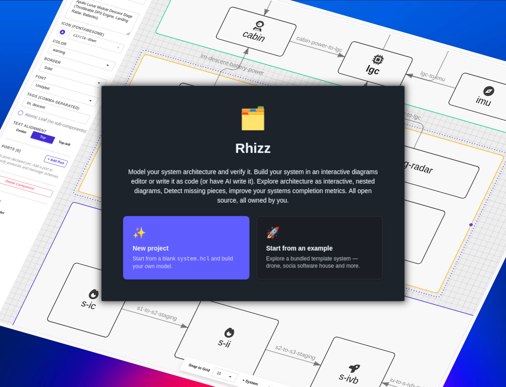

# Rhizz — Rhizomatic Systems Engineering

Rhizz strives to be an actually useful architecture tool for software
architects. Express high-level system concepts as code and validate them with a
compiler accepting different levels of precision, from a business-level
description, all the way to a byte-by-byte interface definition.

In other words - a code-first [MBSE](https://baczek.me/mbse) tool.



## Core Ideas

**Code-first modeling** — components, interfaces, and messages live in plain HCL
(same syntax as Terraform). All `.hcl` files in a directory are merged into one
model, so you can split the description across as many files as you like.

**Completion score** — `rhizz score` measures how fully a system is decomposed.
Sketch a high-level architecture first, fill in details over time, and track
progress numerically:

```
Components:  8/12 complete  (66.7%)
Interfaces:  3/7  complete  (42.9%)
Messages:    5/10 complete  (50.0%)
Overall:     16/29           55.2%
```

**Definable views** — `view` blocks define filtered perspectives on the
same model, rendered by the web application. Show only power paths, zoom into one subsystem, or hide low-level
wiring for a stakeholder review — all without touching the model itself:

```hcl
view "power-paths" {
  system = "quadcopter"
  filter { include_tags = ["power"]; show_messages = false }
}
```

## Usage

```
rhizz check [path]   # parse and validate
rhizz score [path]   # print completion report
rhizz build [path]   # check + score (default)
rhizz fmt [path]     # format .hcl files in place
rhizz watch [path]   # rebuild on file changes
rhizz web            # serve the web editor over HTTP
```

See `SPEC.md`, `SPEC/`, and `examples/` for the full specification and worked
examples.

## Web Server

`rhizz web` is an HTTP server (axum) that serves the compiled web editor and
persists the frontend's virtual filesystem:

```
rhizz web                         # serves UI on 127.0.0.1:3000
rhizz web --addr 0.0.0.0:8080     # custom bind address
rhizz web --data-dir /data        # custom data directory
```

## Development commands

See the [Justfile](Justfile).

## Misc Links

- [WASM Bindgen Guide](https://wasm-bindgen.github.io/wasm-bindgen/introduction.html) -
  search engines are not finding it for some reason...
