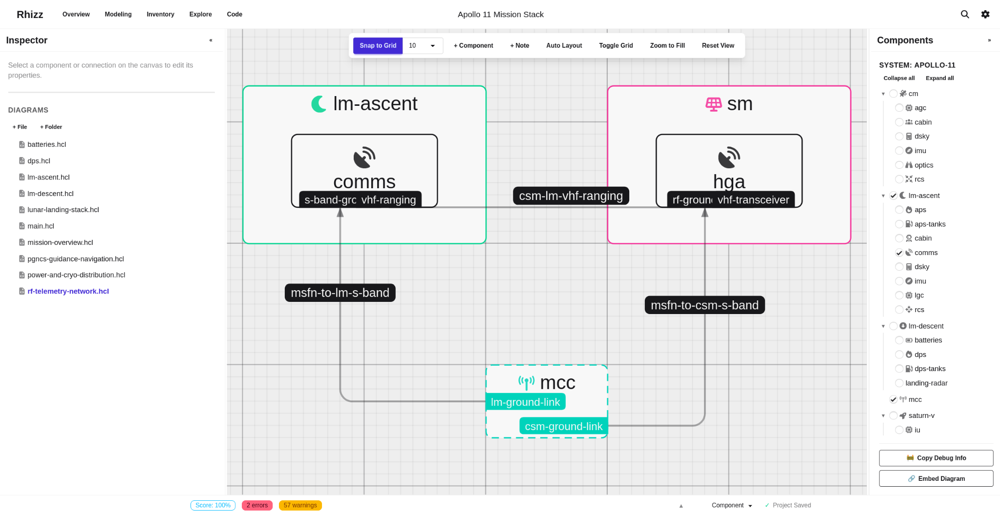
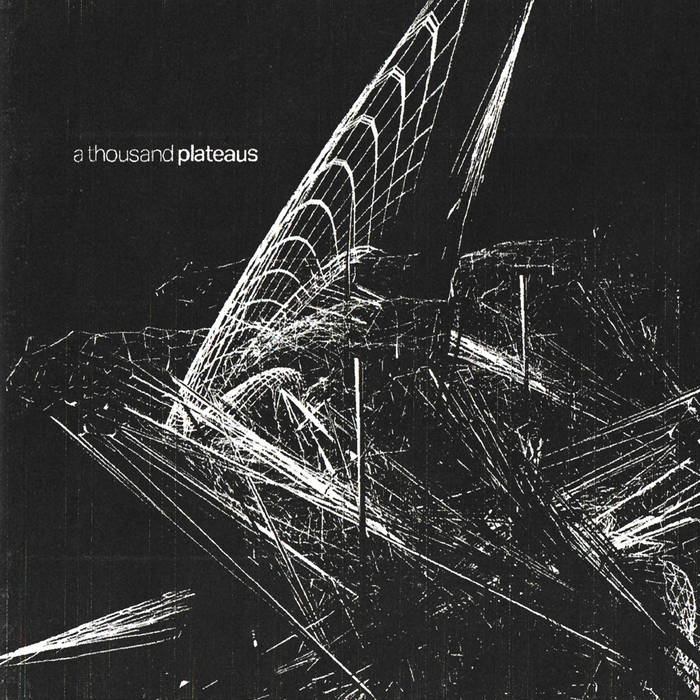
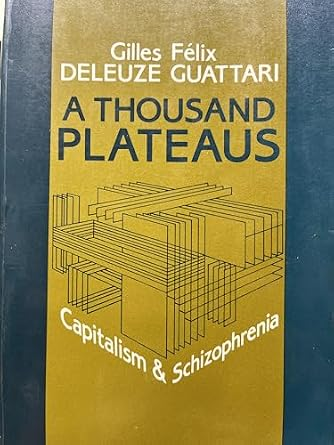

# Rhizz Logo — Generative Explorations

Goal: a generative, LLM-drivable SVG logo for **Rhizz**.
All outputs are code-generated (`params + seed → .svg`), versioned, and self-rendered for review.

## 1. Context — what Rhizz looks like today

* Clean, light SaaS UI: left `Inspector`, center diagram canvas on a subtle grid, right `Components` panel.
* Top-left wordmark is currently plain text: `Rhizz`.
* Diagram language is already graph-based: rounded container cards (`lm-ascent`, `sm`, `mcc`), inner nodes (`comms`, `hga`), labeled edges (`csm-lm-vhf-ranging`, `msfn-to-lm-s-band`).
* Accent colors in use: teal/green `#00D1A1`-ish, pink/magenta, black pills for edge labels, purple `Snap to Grid`.
* Implication for logo: must work at 16px header size, as favicon, and next to diagrams without clashing. Single-color + small-size legibility is critical. Current aesthetic is minimal, rounded, engineering-clean — logo can add character without breaking that.

## 2. Inspiration — `logo_suggestion_chatgpt.png`

ChatGPT's literal take on "Rhizome":

* Icon left, bold geometric sans wordmark right (`Rhizome`).
* Icon: central branching hub with 6 circular terminals, thick rounded strokes, varying branch lengths/angles. No hierarchy, no center — classic rhizome / mycelium / network metaphor.
* Pure black on white, no gradients. Very scalable, works as favicon, stencil, emboss.
* Takeaway: the **node-and-branch mark** is the obvious semantic fit for Rhizz (rhizome → rhizz). Keep: round terminals, thick strokes, asymmetric organic branching. Avoid: too literal / too complex to read at small sizes. Our generative version should parametrize: `branch count, angle spread, node radius, stroke width, rounding`.

## 3. Inspiration — `thousand_plateaus_1.jpg` (book cover)

Deleuze & Guattari, *A Thousand Plateaus: Capitalism & Schizophrenia* — 70s mustard/gold edition:

* Isometric wireframe of stacked, intersecting plates / scaffolds / city levels. Architectural, structuralist, precise line-art.
* Palette: mustard gold field, dark navy spine, black thin lines.
* Takeaway: the **plateau / stacked-layer** metaphor. Rhizz diagrams are already stacked containers (system → subsystem → component). A logo built from 2-3 offset isometric grids / translucent plates could bridge philosophy reference + app reality. Generative knobs: `layers, isometric tilt, offset, line density, intersections`.

## 4. Inspiration — `thousand_plateaus_2.jpg` (distressed mesh)

Black cover, white distressed wireframe:

* Deconstructed topographic mesh / warped grid flying apart, with photocopy noise and scratches. Chaotic, rhizomatic lines shooting across, dense knot lower-right, airy sail upper-right.
* Type is tiny, quiet, lower-case: `a thousand plateaus` — lets the graphics dominate.
* Takeaway: the **wild / generative / glitch** pole. Same grid idea as (3) but distorted, eroded, organic. Perfect moodboard for generative experiments: take a clean grid → apply flow-field warp, random deletion, line-weight jitter → get living mycelium from rigid structure. Generative knobs: `warp amplitude, tear probability, noise texture, density falloff`.

## 5. Synthesis — directions to explore generatively

1. **Rhizome Mark (minimal):** thick rounded branching with dot terminals, like (2), but seeded. Must read at 16px. Single path, single color. Best bet for app header/favicon.
2. **Plateau Stack (geometric):** 2-4 isometric wireframe plates, like (3). More distinctive, more "deep tech". Harder at small sizes — maybe secondary / hero logo.
3. **Warped Grid (textural):** clean grid → generative warp/tear, like (4). Great for landing page, background, loading art. Probably too detailed for icon, but could yield a favicon by zooming into densest knot.
4. **Hybrid:** rhizome branches constrained to isometric plateau lines — organic topology on rigid geometry. Most original, most code-driven.

Constraints for all:
* SVG only, no fonts embedded (convert text to paths for final).
* Light + dark + mono variants from same generator.
* Legible at 16, 32, 128, 512px — we will rasterize and review each.
* Seeded RNG, `params.json` versioned per render.

## 6. Drawing stack (why this, not p5 / Paper / Python)

* **Generator A (zero-dep): Node 24 ESM** — `src/generate.mjs` is pure `(seed, variant) -> SVG string`.
  String-templated SVG + hand-rolled `mulberry32` RNG. No bundler, no framework.
  Fastest loop for grids, strokes, parametric sketching.
* **Generator B (paper.js): Node + `paper` + `jsdom` + `canvas`** — `src/paper-rhizome.mjs`.
  Real primitives (`Path.Circle`, `Path.Line` with round caps), boolean ops (`unite()` the node
  cluster into ONE silhouette path, `subtract()` for hub cut-outs), `exportSVG()`.
  Headless via jsdom; `canvas` npm package gives jsdom the 2D context paper requires at import.
  Lessons already learned: never `simplify()` united arcs (deforms circles into lumps),
  re-assert `fillRule = 'evenodd'` AFTER `subtract()` (new path resets to nonzero),
  start branches at hub perimeter + draw silhouette last so the hub hole stays visible.
* **Env: `flake.nix`** — pinned `nodejs_24 + typescript + resvg + librsvg + imagemagick + svgo + python3
  + pkg-config + cairo + pango` (last three so the `canvas` native module builds/installs).
  `nix develop` gives everyone (human + agent) the same binaries. JS deps via `package.json`
  (`paper`, `jsdom`, `canvas`).
* **See-my-own-work loop (the constraint you added):**
  1. `node src/generate.mjs --variant rhizome --seed 1 --seed-end 6 --outdir renders`
  2. `resvg renders/x.svg renders/png/x.png` (or `resvg --background white` for thin black line-art)
     — I read the PNG back with vision, no human needed in the loop.
  3. `preview.html` + `python3 -m http.server 8000` — same SVGs in browser at 16/32/128px,
     light + dark cards, via `browser_navigate` + screenshot for in-context check.
  4. `montage renders/png/*.png -tile 3x2 -geometry +4+4 sheet.png` — contact sheets for comparison.
  5. `svgo` only at hand-off, never during exploration (keeps diffs readable).
* **Variants today:** `rhizome` (header/favicon bet), `plateau` (isometric diamonds),
  `mesh` (warped grid — jitter each node ONCE then connect, else confetti).
  See `src/generate.mjs: VARIANTS`.

## 7. First carve (v001, self-reviewed)

* `renders/rhizome-001..006.svg` — closest to the ChatGPT ref, thick rounded branches + dot terminals.
  Reads at small size, organic but controlled. Current frontrunner.
* `renders/plateau-001..002.svg` — stacked isometric diamonds, book-cover vibe. Clean but needs
  more seed variation (both seeds look near-identical).
* `renders/mesh-001..002.svg` — connected warped grid, good for hero/background texture, too busy for icon.
* Review PNGs: `renders/png/sheet-rhizome.png`, `renders/png/sheet-plateau-mesh.png`
  (thin line-art rendered with `resvg --background white` — transparent + black strokes
  are invisible in the vision viewer otherwise).
* `renders/paper-rhizome-001..004.svg` — same rhizome topology via paper.js, but the node cluster
  is a single united silhouette (better for font-embedding / cutting). Self-reviewed crisp.
  `renders/paper-rhizome-hole.svg` (`--hub-hole 12`) — donut-hub variant, hole punches cleanly.
  See `renders/png/sheet-paper.png`.

## 8. Lockup — `<mark> Rhizome` in Roboto Bold

* `src/lockup.mjs` — composes a paper.js mark with a Roboto Bold wordmark **converted to
  outlines** (opentype.js, vendored `assets/Roboto-Bold.ttf`), so the SVG needs no webfont.
  Layout is optical: icon content height = 1.18 × cap-height, content center on cap middle,
  gap = 0.42 × cap-height. Tunables: `--gap`, `--icon`, `--font-size`, `--text`.
* Stages (all written every run): input mark (mark-alone) → `<out>-text.svg` (wordmark alone)
  → `<out>.svg` (final lockup). Current: `renders/lockup-001.svg` (seed 1, pick) +
  `renders/lockup-002.svg` (seed 2, more symmetric alternative).
* Small-size check passed: lockup legible at 96px wide, mark alone reads at 32px
  (`renders/png/lockup-001-small.png`, `renders/png/mark-001-32.png`).
* Generator fix found via lockup: marks could bleed past the 512 box (seed 2 hit x=-10.65).
  `paper-rhizome.mjs` now auto-fits every seed into the box with 24-unit margin and emits
  `<mark>.bounds.json` (measured `strokeBounds`), which the lockup consumes — no guessing.
* opentype.js gotchas documented in code: use CJS default import, manual per-glyph layout
  (`font.getPath` shaping crashes on Roboto's ccmp table).

## 9. v002 refinement pass (style 1)

* Uniform terminals (`nodeR` exact, hub 32 ≈ 1.23×), slotted fan (28° min separation),
  tapered branches (`taperStep` 0.72, built as filled round-capped quads — strokes can't taper),
  branches + nodes united into ONE path, mid-node noise removed, tracking −15.
* Fix found in review: narrow sub-forks united into "wishbone" webs — raised `subSep` 0.35 → 0.55.
* Output in `renders/v002/` (v001 kept for comparison); gallery has a v002 section.
  Pick still seed 1. Remaining nit: a few terminal pairs nearly kiss (seed 4 top-right) —
  next knob if it bothers you.

## 10. Hybrid — mesh × rhizome (`src/hybrid.mjs`)

* Branches walk grid-node to grid-node on the warped mesh (9×9, warp 40, 28% edges
  dropped), terminals + hub as dots, torn grid at 0.22 opacity underneath.
* Walks score momentum + outward bias + jitter; shared visited set, one child fork each.
* First attempt on a 7×7 grid tangled (walks crossed, terminals piled) — bigger grid +
  stronger outward bias fixed it. Output in `renders/hybrid/`, pick is seed 1.
* Next if it wins: paper-ify (taper + unite like v002) and build a lockup on it.

## 11. Metaballs — the reference, faithfully (`src/metaball.mjs`)

* Analytic metaballs: hub + terminals + tapered-branch discs as circle SDFs, combined with
  polynomial smooth-minimum (`--smooth`, default 16). d=0 contour traced via marching squares
  (interior-left winding, saddle by center average) + 2× Chaikin, emitted as ONE pure path.
  No SVG filters anywhere — the goo is baked into geometry.
* Debugging trail worth keeping: (1) complementary marching-squares cases must emit REVERSED
  directions or loops fragment into slivers; (2) discs-per-segment must be dense enough for
  smin to bridge (4 → 8); (3) layout bleed past the box = open contours = chord artifacts —
  auto-fit blobs before sampling (found via vertex-degree census: two degree-1 verts on y=512).
* Chunky proportions (`--set baseLen=90,nodeR=30,hubR=36`, seed 2) match the ChatGPT ref:
  `renders/metaball-chunky-lockup.svg`, side-by-side in `renders/png/vs-final.png`.
  32px legibility holds. `--set k=v` overrides any default per run.

## 12. Parametric editor (`editor/`, paper.js)

* Interactive model of the metaball mark: paper.js skeleton (draggable node handles +
  edge lines) over a live analytic-metaball fill — the same tracer as `src/metaball.mjs`,
  imported directly (`blobsToSvg`), no duplication. Drag to move, click to select,
  double-click to grow/connect, Del to remove, sliders for radii / edge tapers / goo / width.
* Seed layouts load as editable node/edge JSON (`editor/models/chunky-00N.json`,
  generated via `node src/metaball.mjs --model ...`). Export SVG (384-grid) + PNG in-browser.
* Serve the repo root (`python3 -m http.server` in `nix develop`) and open `/editor/`.
  paper.js loads from pinned CDN (0.12.20); `window.__editor` hook for console/tests.

## 13. v003 — `molecule.mjs`: stop approximating, measure and trace exactly

The metaball pass (§11) was chasing the reference with the wrong primitive. Two
measurements settled it:

* **`src/measure-ref.mjs`** — threshold the reference bitmap → exact Euclidean distance
  transform (Felzenszwalb) → local DT maxima are dot centres (DT value = radius), modal
  ridge DT is the bar half-width. Results: 6 terminals at r≈37px, bar width 27px,
  **bar/dot-diameter = 0.365**, hub-arm angles −77°/20°/79°/137°/−160° — *not* evenly slotted.
* **`src/diff-ref.mjs`** — IoU scorer. Both masks trimmed to ink bbox + letterboxed into
  512², so the number is shape-only. Red/blue/black overlay PNG for reading the residual.

Three findings invalidated every earlier generator:
1. **There is no hub dot.** Four bars simply converge; `editor/models/reference.json`'s
   `r: 38` hub was invented. (The DT centroid *looks* like a hub because the bars' own ink
   drags it — IoU fitting moved the true confluence by +18/−15.)
2. **Bars are constant width**, not tapered. `taperStep` was modelling nothing.
3. **Joints are small concave fillets** (≈9 units), which is exactly what neither sharp
   booleans nor a global `smin` can produce.

So: the mark is a **tree of circles joined by constant-width capsules**, and that silhouette
can be traced *exactly*. `src/molecule.mjs` walks the boundary (interior kept on the left),
alternating node-circle arcs with capsule side lines and inserting a tangent fillet arc at
each concave corner — emitting ONE path of real `A`/`L` commands. No marching squares (no
polyline soup, no chord artifacts), no boolean ops, no filters, zero deps.

| generator | IoU vs reference |
|---|---|
| `molecule.mjs --preset reference` | **93.11%** |
| `reference-mark.svg` (correct geometry, metaball tracer) | 50.08% |
| `v002/paper-rhizome-001.svg` | 29.66% |
| `metaball-chunky/metaball-002.svg` | 26.95% |

Lessons from this pass:
* **Derive the junction radius, don't tune it.** Two adjacent bars' facing sides cross at
  `h/sin(t/2)` from the centre; if the node circle is smaller it gets overrun and the walk
  emits spikes. Computing that per node is what lets `hubR` stay small while the 4-bar
  confluence stays smooth.
* **A tracer bug and a layout bug look alike.** Seed 4 enclosed negative space — not a
  tracer fault but a chained dot drifting back into the cluster, breaking the tree
  assumption. Fixed with a clearance test (`clearance`, reject-and-retry on turn sign).
* **`canvas` is CJS *and* ships no `Path2D`** in this build — `fit-ref.mjs` scores via resvg
  instead (~50ms/trial, and it's the same rasterizer used for review).
* 16px is beyond 6 dots. The favicon is just different params:
  `--set arms=3,chains=1,dotR=58,barW=38` — one generator, two sizes.

Params: `dotR, barW, hubR, fillet, jointFillet, arms, chains, armLen, chainLen, spread,
chainTurn, minSep, clearance`. Output in `renders/molecule/`, gallery section §0.

## 14. The fillet system (what makes it organic)

First pass still had sharp V-spikes at the hub. The cause was in the tracer, not the layout:
there are **two structurally different concave corners**, and treating them as one is the bug.

* **A · dot joint** — the node circle pokes out past the bar, so the bar's side line runs into
  the circle. Fillet is tangent to a **line and a circle**: centre at `r+f` from the node
  centre and `h+f` from the bar axis, which pins it exactly. Radius = `fillet` (9).
* **B · notch** — two bars converge steeply enough that their facing sides cross *before*
  reaching the circle, which is swallowed. This is **every corner of the reference's hub**,
  since that hub has no dot. Fillet is the circle inscribed in the angle between **two lines**,
  `t = f/tan(phi/2)` back along each side, clamped to 0.42x the shorter bar so tangent points
  stay on the bars. Radius = `jointFillet` (16).

v003 grew the node radius until B degenerated into A (`h/sin(t/2)`), then bridged the rest with
a straight `L` — a hard corner exactly where the reference is softest. Handling B natively
removed the need to inflate radii at all, so `hubR` is now honest geometry.

**The metric cannot judge this.** IoU keeps *rising* as `jointFillet` grows (93.0% at 16 →
93.5% at 70) because it only rewards filled area — but by 48 the fillets web across the bars,
which is precisely the metaball goo failure from §11. Pick (16) was made by eye off
`renders/png/molecule-fillet-sweep.png`; IoU's job is only to catch geometry *drift*.
Worth remembering: a pixel metric guards fidelity, never taste.

## References

* `references/full_app_screenshot.png` — Rhizz app, Apollo 11 Mission Stack view
* `references/logo_suggestion_chatgpt.png` — ChatGPT Rhizome proposal
* `references/thousand_plateaus_1.jpg` — book cover, stacked wireframe plates
* `references/thousand_plateaus_2.jpg` — distressed mesh cover

## Tooling added for v003

* `src/molecule.mjs` — exact-outline generator (the pick), two-case fillet system.
  `--preset reference` or `--seed N`.
* `src/measure-ref.mjs` — distance-transform measurement of the reference bitmap.
* `src/fit-ref.mjs` — coordinate descent on IoU; prints the tuned params.
* `src/diff-ref.mjs` — IoU score + red/blue/black overlay for any rendered PNG.
