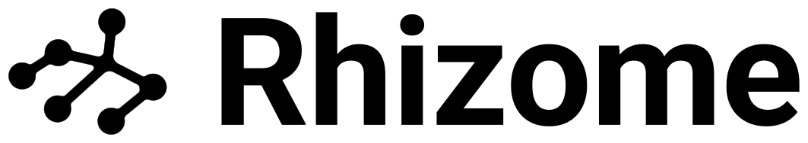
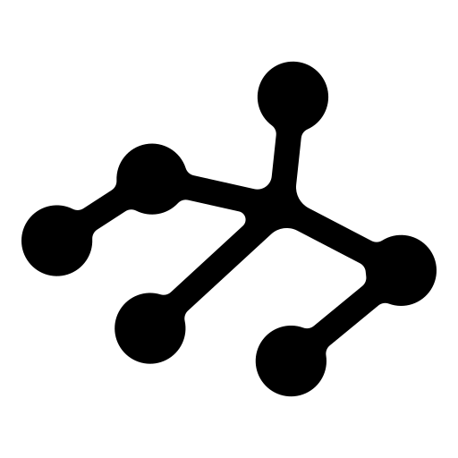
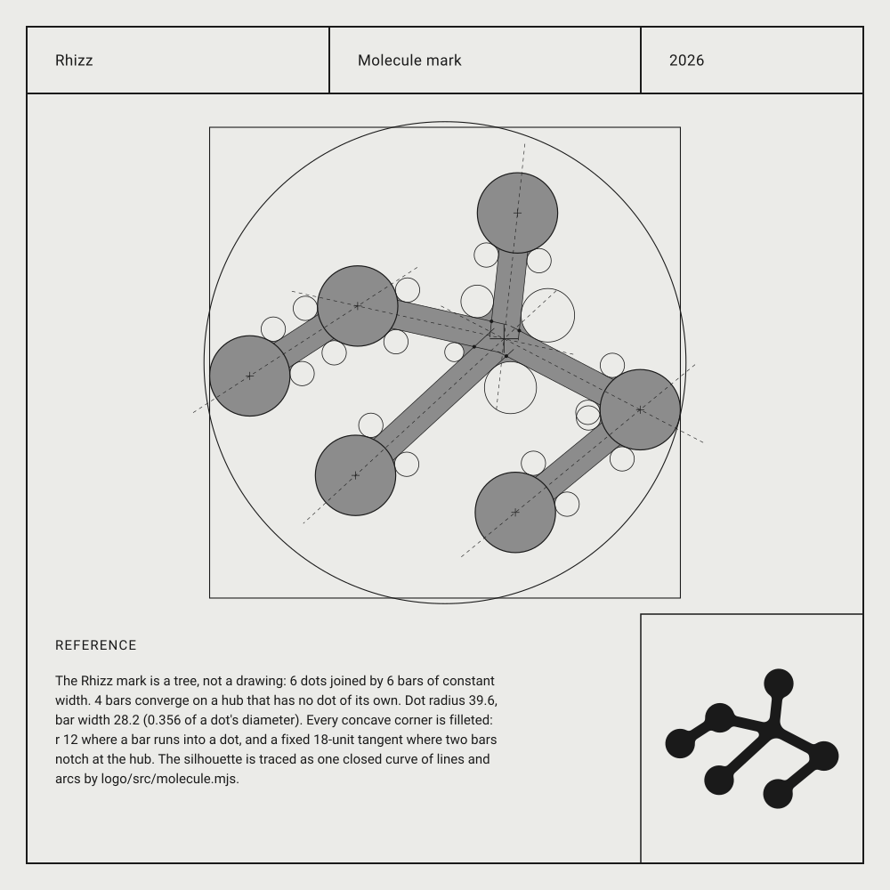

# Rhizome brandbook

<p align="center">
  <picture>
    <source media="(prefers-color-scheme: dark)" srcset="renders/molecule/lockup-ref-white.svg">
    
  </picture>
</p>

The Rhizome identity is generated from code, not drawn by hand. Every graphic
on this page is a build output of the scripts in `src/`. To change the brand,
change the parameters and regenerate (see [Files](#files)).

## The mark

<p align="center">
  <picture>
    <source media="(prefers-color-scheme: dark)" srcset="renders/molecule/molecule-ref-white.svg">
    
  </picture>
</p>

A rhizome is a root network with no trunk and no top. The mark draws one as a
**molecule**: six dots joined by bars, branching out from a meeting point that
has no dot of its own. The bars carry the structure and the dots are where it
ends. Nothing sits at the centre.

The mark is one solid shape with one closed outline. There are no strokes,
overlaps or gaps, so it holds up as a mask, a stamp, a favicon or a cut-out.

## Construction

<p align="center">
  <picture>
    <source media="(prefers-color-scheme: dark)" srcset="renders/molecule/construction-ref-dark.svg">
    
  </picture>
</p>

Every guide in this drawing comes out of the same code that traces the mark, so
the drawing can't drift from the logo.

| Element | Rule (512-unit canvas) |
| --- | --- |
| **Dots** | 6 circles of radius **39.6** |
| **Bars** | constant width **28.2**: 0.356 of a dot's diameter, no taper |
| **Hub** | 4 bars meet at one point, with no dot there |
| **Chains** | 2 arms continue past their first dot to a second one |
| **Dot joints** | where a bar meets a dot, the corner is rounded with a radius of **12** |
| **Hub notches** | where two bars meet at the hub, each corner is rounded starting a fixed **18** units from the corner, so all hub corners match |
| **Fit** | the mark sits centred on the 512 canvas with a 24-unit margin |

The rounded inside corners give the mark its organic feel. Without them, the
same circles and bars read as a technical diagram.

## Wordmark and lockup

- **Typeface:** Roboto Bold, converted to outlines, so no webfont is needed.
- **Tracking:** tightened by 15 font units per glyph.
- **Mark size:** the mark is 1.18 × the cap height, centred on the middle of
  the caps.
- **Gap:** 0.42 × the cap height between the mark and the wordmark.

## Colour

The mark and the lockup are **single-colour**: black on light backgrounds,
white on dark ones. Never split the mark into several colours. In the web app
the mark is applied as a mask over the current text colour, so it follows the
light and dark themes automatically.

The landing page pairs the mark with a soft pastel gradient
(`web/assets/landing-gradient.jpg`) in butter, blush, lilac, periwinkle, teal
and mint. Use it as a background, never inside the wordmark.

## Usage

- **Clear space:** keep at least one dot diameter free around the mark on every
  side.
- **Minimum size:** 20 px tall on screen. That's the size of the web app's
  navbar logo.
- **Do** scale the mark uniformly and use it alone where space is tight.
- **Don't** rotate, mirror, stretch or outline the mark, add a dot at the hub,
  or rebuild it from the construction drawing by hand.

## Files

| File | What it is | Built by |
| --- | --- | --- |
| `renders/molecule/molecule-ref.svg` | the mark (also copied to `web/assets/logo-mark.svg`) | `src/molecule.mjs` |
| `renders/molecule/lockup-ref.svg` | mark + wordmark | `src/lockup.mjs` |
| `renders/molecule/construction-ref.svg` | construction drawing | `src/construction.mjs` |
| `renders/molecule/*-white.svg`, `construction-ref-dark.svg` | the same, for dark backgrounds | the same scripts, with `--fill '#fff'` or `--theme dark` |
| `renders/video/rhizome-gradient-{light,dark}.mp4` | Full HD looping video of the mark with a flowing gradient (not committed) | `src/gradient.mjs` via `just logo-video` |

The images on this page switch to their dark-background variants when GitHub
is in a dark theme (`<picture>` with `prefers-color-scheme`).

The SVGs are build outputs: change the generators, never the SVGs. To
regenerate:

```bash
just assets
```

This also regenerates the landing hero image. The font comes from nixpkgs, so
run it through `just`/nix rather than calling the scripts directly. CI runs
`just assets-check` and fails if a committed SVG differs from what the
generators produce.
