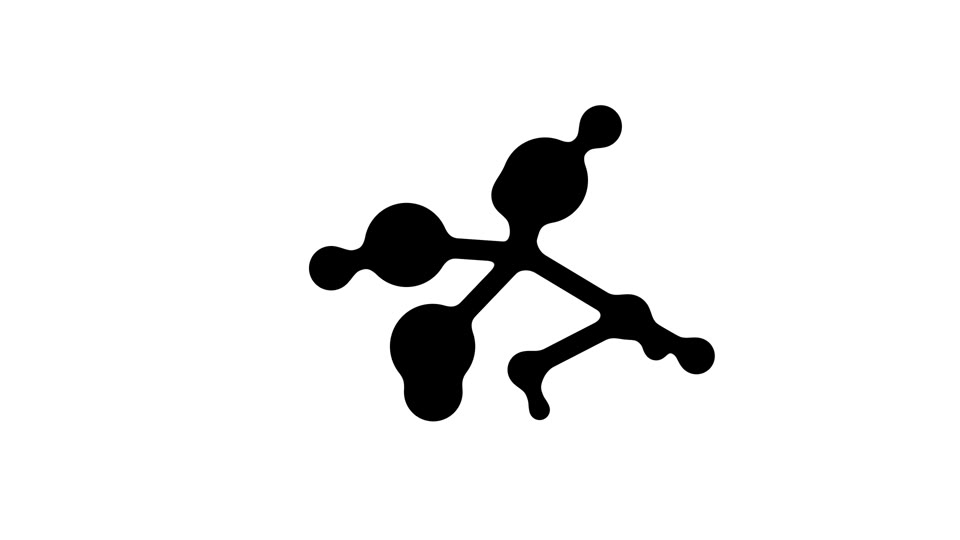

# Rhizome brandbook

<p align="center">
  <picture>
    <source media="(prefers-color-scheme: dark)" srcset="renders/molecule/lockup-ref-white.svg">
    
  </picture>
</p>

The Rhizome identity is generated from code, not drawn by hand. Every graphic
on this page is a build output of the scripts in `src/`. To change the brand,
change the parameters and regenerate (see [Files](#files)).

## The mark

<p align="center">
  <picture>
    <source media="(prefers-color-scheme: dark)" srcset="renders/molecule/molecule-ref-white.svg">
    
  </picture>
</p>

A rhizome is a root network with no trunk and no top. The mark draws one as a
**molecule**: six dots joined by bars, branching out from a meeting point that
has no dot of its own. The bars carry the structure and the dots are where it
ends. Nothing sits at the centre.

The mark is one solid shape with one closed outline. There are no strokes,
overlaps or gaps, so it holds up as a mask, a stamp, a favicon or a cut-out.

## Construction

<p align="center">
  <picture>
    <source media="(prefers-color-scheme: dark)" srcset="renders/molecule/construction-ref-dark.svg">
    
  </picture>
</p>

Every guide in this drawing comes out of the same code that traces the mark, so
the drawing can't drift from the logo.

The rounded inside corners give the mark its organic feel. Without them, the
same circles and bars read as a technical diagram.

## Wordmark and lockup

- **Typeface:** Roboto Bold, converted to outlines, so no webfont is needed.
- **Tracking:** tightened by 15 font units per glyph.
- **Mark size:** the mark is 1.18 × the cap height, centred on the middle of
  the caps.
- **Gap:** 0.42 × the cap height between the mark and the wordmark.

## Colour

The mark and the lockup are **single-colour**: black on light backgrounds,
white on dark ones. Never split the mark into several colours. In the web app
the mark is applied as a mask over the current text colour, so it follows the
light and dark themes automatically.

The landing page pairs the mark with a soft pastel gradient
(`web/assets/landing-gradient.jpg`) in butter, blush, lilac, periwinkle, teal
and mint. Use it as a background, never inside the wordmark.

## Motion

**Intro.** Five seconds: the network sprouts from the hub, branches grow,
swell and pull back, then everything settles into the mark. The mark slides
into place and "Rhizome" rises in letter by letter, and the finished lockup
holds.

<p align="center">
  <a href="renders/video/rhizome-intro-light.mp4">
    <picture>
      <source media="(prefers-color-scheme: dark)" srcset="renders/video/rhizome-intro-dark.jpg">
      
    </picture>
  </a>
  <br>
  <a href="renders/video/rhizome-intro-light.mp4">Light</a> ·
  <a href="renders/video/rhizome-intro-dark.mp4">Dark</a>
</p>

**Gradient loop.** Eight seconds of a pastel gradient flowing through the mark.
It loops seamlessly, for backgrounds and holding screens.

<p align="center">
  <a href="renders/video/rhizome-gradient-light.mp4">
    <picture>
      <source media="(prefers-color-scheme: dark)" srcset="renders/video/rhizome-gradient-dark.jpg">
      
    </picture>
  </a>
  <br>
  <a href="renders/video/rhizome-gradient-light.mp4">Light</a> ·
  <a href="renders/video/rhizome-gradient-dark.mp4">Dark</a>
</p>

Both are Full HD MP4s. GitHub can't play video inline in a README, so these
are stills: click one to open the video.

## Usage

- **Clear space:** keep at least one dot diameter free around the mark on every
  side.
- **Minimum size:** 20 px tall on screen. That's the size of the web app's
  navbar logo.
- **Do** scale the mark uniformly and use it alone where space is tight.
- **Don't** rotate, mirror, stretch or outline the mark, add a dot at the hub,
  or rebuild it from the construction drawing by hand.

## Files

The images on this page switch to their dark-background variants when GitHub
is in a dark theme (`<picture>` with `prefers-color-scheme`).

The SVGs are build outputs: change the generators, never the SVGs. To
regenerate:

```bash
just assets
```

This also regenerates the landing hero image. The font comes from nixpkgs, so
run it through `just`/nix rather than calling the scripts directly. CI runs
`just assets-check` and fails if a committed SVG differs from what the
generators produce.

`just logo-video` renders the Full HD gradient videos and `just logo-intro` the
5-second logo intro (the network sprouts and settles into the mark, then the
wordmark appears), both into `renders/video/`. The MP4s are committed through Git LFS: re-render
and commit them whenever the generators change, since CI does not check them.
